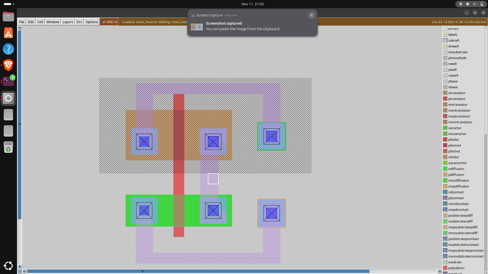
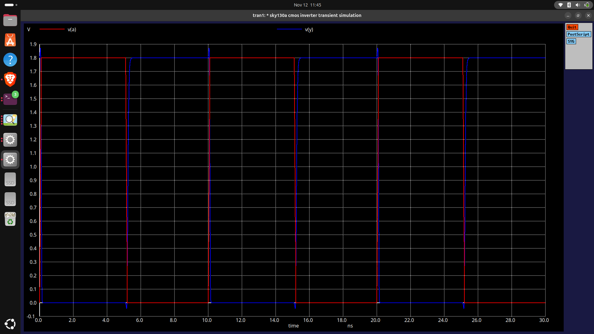

# SKY130A CMOS Inverter — Physical Design and Verification

## Project Overview

This project demonstrates the physical layout design, verification, and transient simulation of a CMOS inverter using the open-source SKY130A Process Design Kit (PDK).

The CMOS inverter was implemented using Magic VLSI, verified through Design Rule Checking (DRC) and Layout Versus Schematic (LVS) comparison, and simulated using ngspice.

## Project Objectives

- Design a CMOS inverter using PMOS and NMOS transistors.
- Implement the physical layout using Magic VLSI.
- Connect the input, output, power supply, and body terminals.
- Perform DRC to identify layout rule violations.
- Extract the SPICE netlist from the physical layout.
- Perform LVS comparison using Netgen.
- Simulate the inverter using SKY130A transistor models.
- Verify the inverter's input-output switching behavior.

## Tools and Technology

| Tool | Purpose |
|---|---|
| Ubuntu Linux | Development environment |
| Magic VLSI 8.3 | Layout design and DRC |
| SKY130A PDK | Technology rules and transistor models |
| Netgen LVS 1.5.133 | Layout connectivity verification |
| ngspice 45.2 | Transient circuit simulation |

## CMOS Inverter Specifications

| Parameter | Value |
|---|---|
| Technology | SKY130A |
| Supply voltage | 1.8 V |
| NMOS width | 0.6 µm |
| NMOS length | 0.2 µm |
| PMOS width | 0.95 µm |
| PMOS length | 0.2 µm |
| Input | A |
| Output | Y |

## Verification Summary

| Verification | Result |
|---|---|
| Design Rule Check | Passed — 0 errors |
| SPICE Extraction | Completed |
| LVS Comparison | Passed — circuits match uniquely |
| ngspice Transient Simulation | Completed — correct inverter switching |


---

## 1. CMOS Inverter Design

A CMOS inverter is a fundamental digital logic circuit that performs the NOT operation.

It consists of two complementary MOS transistors:

- PMOS: Pull-up transistor connected to VDD.
- NMOS: Pull-down transistor connected to GND.

Both transistor gates are connected to the common input A, while their drains are connected to the output Y.

### CMOS Inverter Truth Table

| Input A | Output Y |
|---|---|
| 0 (LOW) | 1 (HIGH) |
| 1 (HIGH) | 0 (LOW) |

### Working Principle

When the input is LOW, the PMOS turns ON and the NMOS turns OFF, producing a HIGH output.

When the input is HIGH, the PMOS turns OFF and the NMOS turns ON, producing a LOW output.

---

## 2. Physical Layout Design Using Magic VLSI

The CMOS inverter layout was designed using Magic VLSI with the SKY130A PDK.

### Layout Implementation

1. Created NMOS and PMOS transistor structures.
2. Connected both transistor gates using polysilicon to form input A.
3. Connected the transistor drains to form output Y.
4. Connected the PMOS source to VDD.
5. Connected the NMOS source to GND.
6. Added N-well and substrate tap connections.
7. Implemented local interconnect and Metal1 routing.
8. Assigned ports for VDD, GND, A, and Y.

### Transistor Dimensions

- NMOS: W = 0.6 µm, L = 0.2 µm
- PMOS: W = 0.95 µm, L = 0.2 µm

### Layout File

`cmos_inverter.mag`

---

### CMOS Inverter Physical Layout



## 3. Design Rule Check (DRC)

Design Rule Checking verifies whether the physical layout follows the manufacturing design rules defined by the SKY130A PDK.

DRC checks include:

- Minimum width requirements
- Minimum spacing requirements
- Contact and via enclosure rules
- Layer overlap requirements
- Well and diffusion layout constraints

### DRC Result

**Final DRC result: 0 errors**

The final CMOS inverter layout passed the Magic VLSI design rule checks.


---

## 4. SPICE Netlist Extraction

After completing the CMOS inverter layout and DRC verification, the circuit connectivity was extracted using Magic VLSI.

The extracted SPICE netlist contains two transistors:

- NMOS: `sky130_fd_pr__nfet_01v8`
- PMOS: `sky130_fd_pr__pfet_01v8`

### Extracted CMOS Inverter Netlist

```spice
.subckt cmos_inverter VDD GND A Y
X0 Y A GND GND sky130_fd_pr__nfet_01v8 w=0.6 l=0.2
X1 Y A VDD VDD sky130_fd_pr__pfet_01v8 w=0.95 l=0.2
.ends

```

The netlist above shows the CMOS inverter's NMOS and PMOS connections. The actual extracted SPICE file also contains source and drain geometry parameters.

### Generated Files

- `cmos_inverter.ext` — Magic extraction file
- `cmos_inverter.spice` — Extracted SPICE netlist

---


## 5. Layout Versus Schematic (LVS) Verification

### Objective

LVS verifies whether the electrical connections extracted from the physical layout match those in a reference circuit netlist.

### Tools Used

- Magic VLSI for layout extraction
- Netgen LVS 1.5.133 for comparison
- SKY130A LVS setup file

### LVS Procedure

1. Completed the CMOS inverter layout in Magic.
2. Extracted the layout connectivity into a SPICE netlist.
3. Prepared a reference CMOS inverter SPICE netlist.
4. Compared both netlists using Netgen.
5. Verified transistor connectivity and device parameters.

### LVS Command

    /usr/bin/netgen-lvs -batch lvs \
    "cmos_inverter.spice cmos_inverter" \
    "cmos_inverter_schematic.spice cmos_inverter" \
    /usr/local/share/pdk/sky130A/libs.tech/netgen/sky130A_setup.tcl \
    cmos_inverter_lvs.log

### LVS Result

    Netlists match uniquely.
    Result: Circuits match uniquely.
    LVS Done.

**LVS Status: PASSED**

The extracted layout matches the manually prepared reference netlist. This is not an independent schematic verification.

### LVS Files

- cmos_inverter.spice
- cmos_inverter_schematic.spice
- cmos_inverter_lvs.log

---


## 6. CMOS Inverter Transient Simulation Using ngspice

### Final CMOS Inverter Simulation Waveform



**Waveform Analysis:**
- Red: Input voltage V(A)
- Blue: Output voltage V(Y)
- Supply voltage: 1.8 V
- Simulation duration: 30 ns
- Result: Output switches opposite to the input, confirming inverter operation.


### Objective

To verify the switching behavior of the CMOS inverter using ngspice and the SKY130A transistor models.

### Simulation Environment

- Simulator: ngspice 45.2
- Technology: SKY130A PDK
- Process Corner: TT (Typical-Typical)
- Supply Voltage: 1.8 V

### Simulation Parameters

| Parameter | Value |
|---|---|
| Supply voltage | 1.8 V |
| Input LOW voltage | 0 V |
| Input HIGH voltage | 1.8 V |
| Pulse period | 10 ns |
| Pulse HIGH duration | 5 ns |
| Rise time | 100 ps |
| Fall time | 100 ps |
| Load capacitance | 5 fF |
| Simulation duration | 30 ns |
| Transient step | 10 ps |

### Simulation Procedure

1. Loaded the SKY130A transistor models.
2. Included the extracted CMOS inverter SPICE netlist.
3. Applied a 1.8 V DC supply.
4. Applied a periodic pulse to input A.
5. Connected a 5 fF load capacitor to output Y.
6. Performed transient analysis using ngspice.
7. Plotted the input and output voltage waveforms.

### Simulation Command

    cd ~/open_pdks
    ngspice cmos_inverter_tb.spice

### Waveform Observations

- Input A switches between 0 V and 1.8 V.
- Output Y switches in the opposite direction.
- When input A is LOW, output Y is HIGH.
- When input A is HIGH, output Y is LOW.
- The waveform confirms CMOS inverter functionality.

### CMOS Inverter Truth Table

| Input A | Output Y |
|---|---|
| 0 V | Approximately 1.8 V |
| 1.8 V | Approximately 0 V |

### Simulation Result

**Transient simulation completed successfully.**

The output waveform demonstrates the expected logical inversion of the input signal.

### Simulation File

`cmos_inverter_tb.spice`

---


## 7. Final Project Results

The SKY130A CMOS inverter was designed, verified, and simulated using open-source VLSI tools.

### Verification Summary

| Stage | Tool | Result |
|---|---|---|
| Physical Layout | Magic VLSI | Completed |
| Design Rule Check | Magic VLSI | Passed - 0 errors |
| SPICE Extraction | Magic VLSI | Completed |
| LVS Verification | Netgen | Passed - Unique match |
| Transient Simulation | ngspice | Passed - Correct inverter switching |

### Key Observations

1. The PMOS and NMOS transistors form a CMOS inverter.
2. The physical layout satisfies the checked SKY130A design rules.
3. The extracted layout matches the manually prepared reference netlist.
4. The transient simulation confirms the expected NOT gate operation.
5. The output voltage switches between approximately 0 V and 1.8 V.

---

## 8. Conclusion

This project demonstrates the physical design and verification of a CMOS inverter using the SKY130A Process Design Kit.

The inverter layout was developed using Magic VLSI. Design Rule Checking was completed with zero reported errors.

The extracted SPICE netlist was compared against a manually prepared reference netlist using Netgen, and the circuits matched uniquely.

Transient simulation was performed using ngspice 45.2. The input and output waveforms demonstrated the expected inverter switching behavior.

The project provided practical experience in CMOS layout design, physical verification, SPICE extraction, LVS comparison, and transistor-level circuit simulation.

---

## 9. References

1. [SkyWater SKY130 PDK Documentation](https://skywater-pdk.readthedocs.io/)
2. [Magic VLSI](http://opencircuitdesign.com/magic/)
3. [Netgen LVS](http://opencircuitdesign.com/netgen/)
4. [ngspice Documentation](https://ngspice.sourceforge.io/docs.html)

